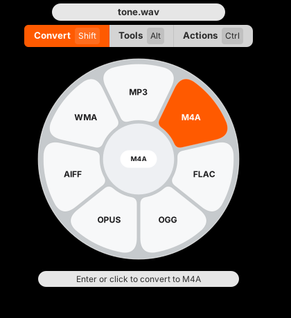
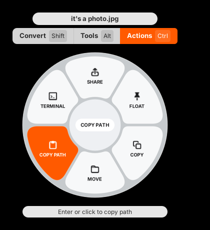
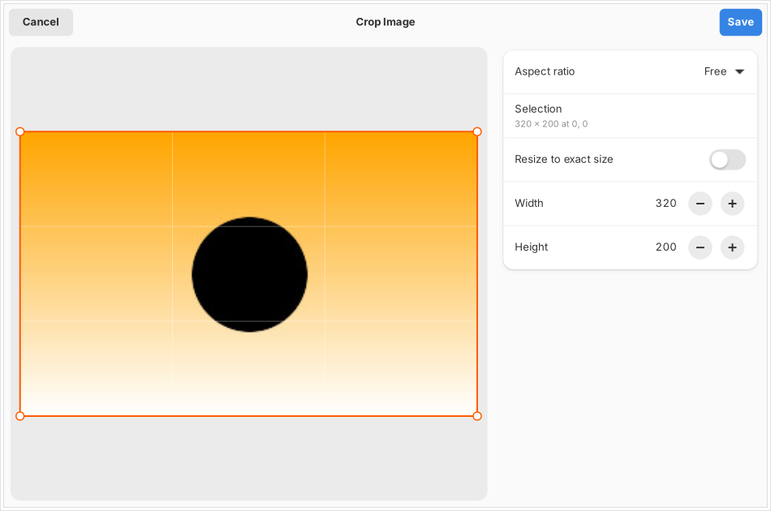

# Satsuma

> [!NOTE]
>
> This app is **completely** generated from AI and is **only** intended for me. Tested on Fedora, Gnome, Wayland only. I won't add support for **any file managers**, **any window manager**, **any display server**.

A Tangerine-style file converter for GNOME. Select files in **Files**,
press **F4**, and a wheel pops up over the screen at your pointer:

One of [GNOME QoL](https://github.com/du-cc/GNOME-QoL) collections.

## Functions

| Key   | Wheel       | What's on it                                                                                                                                                                                                                                                 |
| ----- | ----------- | ------------------------------------------------------------------------------------------------------------------------------------------------------------------------------------------------------------------------------------------------------------ |
| Shift | **Convert** | 268 format pairs: images, audio, video, PDF, documents, slides, spreadsheets, subtitles, archives                                                                                                                                                            |
| Alt   | **Tools**   | 26 tools: compress, edit metadata, edit/annotate/crop/redact photos, add a background, collage, trim/split/crop/speed/redact/join video, snapshots, normalize/trim/bleep audio, audio visualizer, channels, split/merge/organize/create PDF, extract archive |
| Ctrl  | **Actions** | Share, Float (shelf), Copy, Move, Copy Path, Terminal                                                                                                                                                                                                        |

Other ways in:

- **Right-click → Satsuma** in Files: Open Wheel, Convert To ▸, Tools, Float on Shelf
  (needs `nautilus-python`).
- **Open With → Satsuma** on any supported file.
- **Drop zone:** open Satsuma from Activities and drag files onto its window. The
  wheel appears while you drag; hold **Ctrl** (actions) or **Alt** (tools), or hover the
  mode buttons, then let go on a petal.
- **Command line:** `satsuma convert --to webp *.png`, `satsuma tool compress clip.mp4 --set crf=30`,
  `satsuma list file.pdf`, `satsuma doctor`.

## Screenshots

Wheel

<p>
  
  
</p>

Image editor



## Installation

```bash
./install.sh
nautilus -q
```

### Note

This installs into `~/.local`, registers the
F4 shortcut in `~/.config/nautilus/scripts-accels`, adds the context menu,
adds a D-Bus activation file so the wheel opens instantly, and installs the small
**Satsuma Wheel** GNOME Shell extension. GNOME on Wayland doesn't let apps read
the pointer or place their own windows, so the extension moves the wheel under
your pointer and focuses it. Log out and back in once after installing so GNOME
Shell loads it; without it the wheel opens in the middle of the screen. Change the shortcut
in **Preferences → Files**. Remove everything with `./uninstall.sh`.

Patent-encumbered codecs come from RPM Fusion: for H.264 MP4/MOV output and for
opening iPhone HEIC photos, enable RPM Fusion and run
`sudo dnf swap ffmpeg-free ffmpeg --allowerasing` and `sudo dnf install libheif-freeworld`.
Without them Satsuma falls back to OpenH264 or MPEG-4 and dims what it can't do.
**Preferences → Converters** (or `satsuma doctor`) lists what's installed.

There is also an RPM spec: `rpmbuild -ta satsuma-1.0.0.tar.gz`. It installs the
menu and D-Bus service system-wide; each user then runs `satsuma install-integration`
once to get the F4 shortcut.

## Development

### AI

Everything. I only prompt and test bugs.

### Testing

```bash
python3 -m satsuma                   # run from the source tree
python3 -m unittest tests.test_formats tests.test_wheel   # fast
python3 -m unittest tests.test_conversions tests.test_tools   # every conversion and tool, needs the converters
```

### Code map

`formats.py` (catalogue and naming), `backends.py` (conversions),
`tools.py` (file tools), `wheel.py` (the wheel widget), `overlay.py` (hotkey
overlay), `window.py` (drop zone), `dialogs.py` (tool editors), `actions.py`,
`integration.py` (Files hotkey, menu, D-Bus), `app.py`, `cli.py`.
